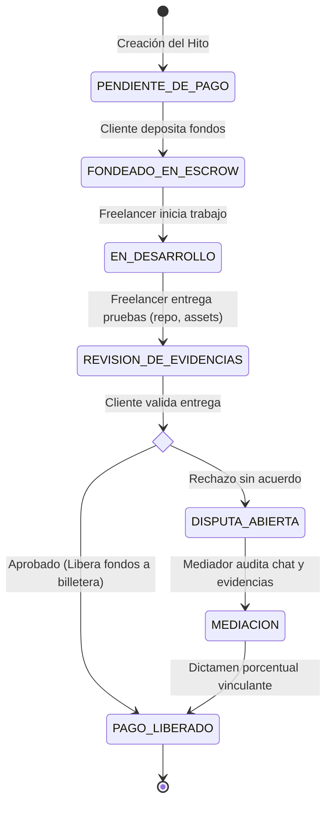
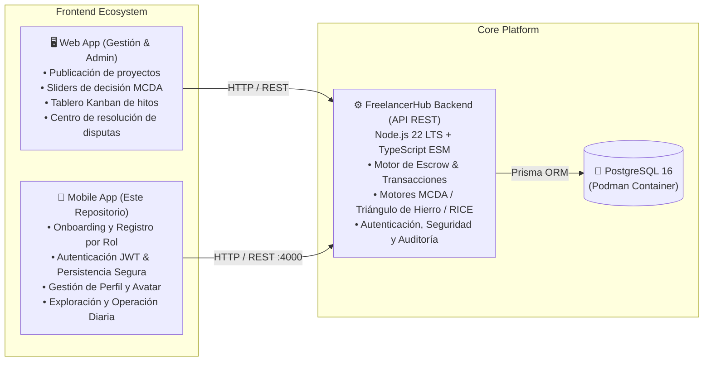

<div align="center">

# 📱 FreelancerHub - Mobile Frontend

**Aplicación móvil multiplataforma para la operación diaria, gestión de perfiles, postulaciones y seguimiento de proyectos con custodia de pago (Escrow) y toma de decisiones algorítmicas.**

[](https://flutter.dev/)
[](https://dart.dev/)
[](https://bloclibrary.dev/)
[](https://pub.dev/packages/flutter_secure_storage)
[](https://github.com/IDGS1004-23001526/freelancer_hub_backend)
[](https://podman.io/)
[](https://m3.material.io/)

<p align="center">
  <a href="#-la-problemática">Problemática</a> •
  <a href="#-solución-y-flujo-escrow">Flujo Escrow</a> •
  <a href="#-módulos-de-decisión-mdp">Módulos de Decisión</a> •
  <a href="#-ecosistema-de-aplicaciones">Ecosistema</a> •
  <a href="#-stack-tecnológico-móvil">Stack</a> •
  <a href="#-arquitectura-y-estructura-del-proyecto">Arquitectura</a> •
  <a href="#-configuración-del-backend-y-podman">Backend & Podman</a> •
  <a href="#-instalación-y-ejecución">Instalación</a> •
  <a href="#-integración-con-endpoints-api-v1">Endpoints API</a>
</p>

</div>

---

## 🎯 La Problemática

En el ecosistema tradicional de trabajo independiente y desarrollo por encargo, la fricción y desconfianza generan pérdidas económicas y retrasos recurrentes:

| Desafío Tradicional | Impacto en Freelancers | Impacto en Clientes |
| :--- | :--- | :--- |
| **Incertidumbre de Pago / Anticipos** | Temor a entregar el producto final y no recibir la liquidación o que el cliente desaparezca. | Temor a soltar anticipos y recibir entregas deficientes, tardías o abandono del proyecto. |
| **Scope Creep Descontrolado** | Presión para realizar cambios continuos (*"nomás cámbiale esto"*) sin presupuesto ni tiempo extra. | Falta de claridad en los límites del alcance y entregables pactados. |
| **Selección Subjetiva** | Dependencia de tarifas a la baja en lugar de visibilidad de valor real y especialización. | Contratación por intuición o corazonadas en vez de evaluación objetiva basada en datos. |

---

## 🛡️ Solución y Flujo Escrow (Custodia Blindada)

**FreelancerHub** opera como un intermediario técnico y financiero neutral con reglas automatizadas por hitos (*milestones*):



1. **Custodia en Escrow (`FONDEADO_EN_ESCROW`):** El cliente fondea el valor del hito antes de iniciar. Los fondos quedan asegurados en la plataforma, garantizando liquidez al freelancer sin riesgo de impago.
2. **Entrega de Evidencias Verificables:** El freelancer registra enlaces a repositorios de código, entregables de diseño, documentación y artefactos.
3. **Liberación Instantánea:** Una vez que el cliente aprueba la entrega desde la app o web, el sistema liquida y transfiere los fondos de forma directa a la billetera digital del freelancer.
4. **Mecanismo de Disputas & Mediación:** Ante desacuerdos no conciliados, los fondos permanecen congelados y un mediador/administrador evalúa el historial de trazabilidad emitiendo una resolución vinculante.

---

## 🧠 Módulos de Decisión (MDP - Mathematical Decision Platform)

El ecosistema FreelancerHub se conecta con los motores matemáticos del backend para eliminar la subjetividad:

```text
                  ┌────────────────────────────────────────┐
                  │      Módulos de Decisión (MDP)         │
                  └───────────────────┬────────────────────┘
                       ┌──────────────┼──────────────┐
                       ▼              ▼              ▼
         ┌──────────────────┐ ┌──────────────┐ ┌──────────────────┐
         │  Ponderador MCDA │ │  Triángulo   │ │  Priorizador     │
         │  (Multi-Criteria)│ │  de Hierro   │ │  RICE            │
         └──────────────────┘ └──────────────┘ └──────────────────┘
```

### 1. 📊 Ponderador MCDA (*Multi-Criteria Decision Analysis*)
Evalúa y clasifica candidatos combinando ponderaciones definidas por el cliente (ej. $40\%$ Presupuesto, $30\%$ Tiempo de Entrega, $30\%$ Reputación/Score):

$$\text{Score}_i = \sum_{j=1}^{m} w_j \cdot v_{ij}$$

### 2. 📐 Regulador del Triángulo de Hierro (*Scope, Cost, Time*)
Control estricto anti-*scope creep*. Cualquier solicitud de cambio funcional recalcula el balance del proyecto y bloquea modificaciones a menos que se apruebe el ajuste proporcional en presupuesto o fecha límite.

### 3. 🚀 Priorizador RICE (*Reach, Impact, Confidence, Effort*)
Estructura y prioriza la lista de entregables e hitos del proyecto maximizando el retorno de inversión:

$$\text{RICE Score} = \frac{\text{Alcance} \times \text{Impacto} \times \text{Confianza}}{\text{Esfuerzo}}$$

---

## 🌐 Ecosistema de Aplicaciones

Este repositorio corresponde a la **Aplicación Móvil (`freelance_hub_movil`)**, que se comunica directamente con la API REST de [`freelancer_hub_backend`](https://github.com/IDGS1004-23001526/freelancer_hub_backend.git):



---

## 🛠️ Stack Tecnológico (Móvil)

- **Framework UI:** [Flutter 3.x](https://flutter.dev/) (Material Design 3)
- **Lenguaje:** [Dart >= 3.0.0 < 4.0.0](https://dart.dev/)
- **Gestión de Estado:** [flutter_bloc ^9.1.1](https://pub.dev/packages/flutter_bloc) + [equatable ^3.0.0](https://pub.dev/packages/equatable)
- **Cliente HTTP:** [http ^1.2.2](https://pub.dev/packages/http) con estrategia de *fallback* automático (`10.0.2.2` / `localhost`)
- **Almacenamiento Seguro:** [flutter_secure_storage ^9.2.2](https://pub.dev/packages/flutter_secure_storage) (Keychain en iOS / EncryptedSharedPreferences & Keystore en Android)
- **Captura e Imágenes:** [image_picker ^1.1.2](https://pub.dev/packages/image_picker) (Cámara y Galería para avatar de usuario)
- **Tipografía:** [google_fonts ^6.2.1](https://pub.dev/packages/google_fonts) (Tipografía *Plus Jakarta Sans*)

---

## 📂 Arquitectura y Estructura del Proyecto

La aplicación sigue una arquitectura modular separada por capas de presentación, lógica de negocio (**BLoC**), servicios de datos y modelos:

```text
freelancer_mobile_frontend/
├── android/ & ios/                      # Configuraciones nativas por plataforma
├── lib/
│   ├── bloc/
│   │   └── auth/
│   │       ├── auth_bloc.dart           # Lógica reactiva de sesión, login, registro y perfil
│   │       ├── auth_event.dart          # Eventos de autenticación (Login, Register, Logout, Update)
│   │       └── auth_state.dart          # Estados inmutables (Initial, Loading, Authenticated, Error)
│   ├── config/
│   │   └── api_constants.dart           # Rutas de API v1 (10.0.2.2:4000 y localhost:4000)
│   ├── models/
│   │   └── user_profile.dart            # Modelo de dominio UserProfile y serialización JSON
│   ├── screens/
│   │   ├── auth/
│   │   │   ├── onboarding_screen.dart   # Pantalla de bienvenida e introducción a la plataforma
│   │   │   ├── login_screen.dart        # Inicio de sesión con validación y feedback reactivo
│   │   │   └── register_screen.dart     # Registro con selector de rol (FREELANCER / CLIENT)
│   │   ├── errors/
│   │   │   └── unauthorized_screen.dart # Guardia de seguridad para accesos no autorizados (401/403)
│   │   └── profile/
│   │       ├── profile_screen.dart      # Vista de perfil profesional, rol, habilidades y cierre de sesión
│   │       └── edit_profile_screen.dart # Edición de datos de perfil, habilidades y fotografía
│   ├── services/
│   │   ├── auth_service.dart            # Consumo de /api/v1/auth/* y persistencia JWT en SecureStorage
│   │   └── profile_service.dart         # Consulta de perfil (/auth/me) y subida multipart de avatar
│   ├── theme/
│   │   └── app_colors.dart              # Paleta de colores corporativa y tokens de diseño
│   ├── utils/
│   │   └── form_validators.dart         # Validadores de correo, contraseñas fuertes y campos requeridos
│   ├── widgets/
│   │   ├── custom_text_field.dart       # Campo de texto reutilizable con soporte de validación
│   │   ├── primary_button.dart          # Botón principal con indicador de carga integrado
│   │   ├── profile_menu_item.dart       # Elemento de menú para opciones de perfil
│   │   └── role_selection_card.dart     # Tarjeta interactiva para elegir rol Cliente o Freelancer
│   └── main.dart                        # Punto de entrada e inyección global de AuthBloc
├── test/
│   └── widget_test.dart                 # Pruebas de widgets y flujo de la aplicación
└── pubspec.yaml                         # Declaración de dependencias y configuración de Flutter
```

---

## 🐘 Configuración del Backend y Podman

Para que la aplicación móvil pueda autenticar usuarios y sincronizar perfiles en tiempo real, debes tener en ejecución el repositorio **[`freelancer_hub_backend`](https://github.com/IDGS1004-23001526/freelancer_hub_backend.git)** junto con su contenedor **PostgreSQL 16** en **Podman**.

### 1. Clonar e instalar el Backend
```bash
git clone https://github.com/IDGS1004-23001526/freelancer_hub_backend.git
cd freelancer_hub_backend
pnpm install
cp .env.example .env
```

### 2. Inicializar Podman y Base de Datos PostgreSQL 16

#### 🪟 En Windows (PowerShell)
```powershell
# 1. Inicializar y arrancar la máquina virtual de Podman (si es la primera vez)
podman machine init
podman machine start

# 2. Levantar el contenedor PostgreSQL mediante el script del backend
pnpm db:up:win

# O manualmente con Podman:
podman volume create freelancer_hub_pgdata
podman run -d `
  --name freelancer_hub_db `
  -e POSTGRES_USER=postgres `
  -e POSTGRES_PASSWORD=postgres `
  -e POSTGRES_DB=freelancer_hub `
  -p 5432:5432 `
  -v freelancer_hub_pgdata:/var/lib/postgresql/data `
  docker.io/library/postgres:16-alpine
```

#### 🐧 En Linux (Bash)
```bash
# Mediante el script automatizado del backend
pnpm db:up
```

### 3. Sincronizar Prisma e iniciar el servidor API (Puerto `4000`)
```bash
pnpm prisma:generate
pnpm dev
```
> El backend quedará escuchando en `http://localhost:4000`. Puedes verificar su estado en `http://localhost:4000/api/health` o explorar la documentación Swagger en `http://localhost:4000/api/docs`.

---

## 🚀 Instalación y Ejecución (App Móvil)

### Prerrequisitos
- **Flutter SDK**: `>= 3.0.0`
- **Android Studio** / **VS Code** con extensiones de Flutter y Dart
- **Emulador Android** (AVD) o dispositivo físico con depuración USB activa
- **Backend activo** en el puerto `4000`

### 1. Clonar este repositorio
```bash
git clone <URL_DEL_REPOSITORIO_MOVIL>
cd freelancer_mobile_frontend
```

### 2. Instalar paquetes de Flutter
```bash
flutter pub get
```

### 3. Conexión de Red entre Dispositivo / Emulador y Backend

La clase `ApiConstants` (`lib/config/api_constants.dart`) incluye resolución inteligente con *fallback* automático:

- **Emulador Android (Por defecto):** Apunta automáticamente a `http://10.0.2.2:4000/api/v1` (puente de red nativo del emulador hacia el `localhost` de tu máquina).
- **Dispositivo Físico por USB (Recomendado con `adb reverse`):**
  Ejecuta el siguiente comando para redirigir el puerto `4000` del teléfono al puerto `4000` de tu computadora:
  ```bash
  adb reverse tcp:4000 tcp:4000
  ```
  El servicio `AuthService` utilizará automáticamente el respaldo `http://localhost:4000/api/v1`.

### 4. Ejecutar la aplicación
```bash
flutter run
```

### 5. Ejecutar pruebas y análisis estático
```bash
# Análisis de código (linter)
flutter analyze

# Ejecución de pruebas
flutter test
```

---

## 🔌 Integración con Endpoints (API v1)

La aplicación móvil consume los siguientes endpoints provistos por `freelancer_hub_backend`:

| Método | Endpoint | Uso en la App Móvil | Autenticación |
| :--- | :--- | :--- | :--- |
| `POST` | `/api/v1/auth/register` | Registro de cuenta nueva con rol `FREELANCER` o `CLIENT` desde `RegisterScreen`. | Público |
| `POST` | `/api/v1/auth/login` | Inicio de sesión desde `LoginScreen`, almacenamiento de `accessToken` y `refreshToken` en `FlutterSecureStorage`. | Público |
| `GET` | `/api/v1/auth/me` | Obtención y sincronización de los datos del perfil autenticado en `ProfileScreen`. | `Bearer <token>` |
| `POST` | `/api/v1/auth/refresh-token` | Renovación de sesión mediante rotación de Refresh Token. | Público |
| `POST` | `/api/v1/auth/logout` | Revocación de sesión y limpieza de credenciales seguras locales. | Público / Token |
| `POST` | `/api/v1/users/avatar` | Actualización de fotografía de perfil vía `MultipartRequest`. | `Bearer <token>` |

---

## 📄 Licencia

Este proyecto forma parte del ecosistema **FreelancerHub** y está bajo la Licencia **ISC**.
